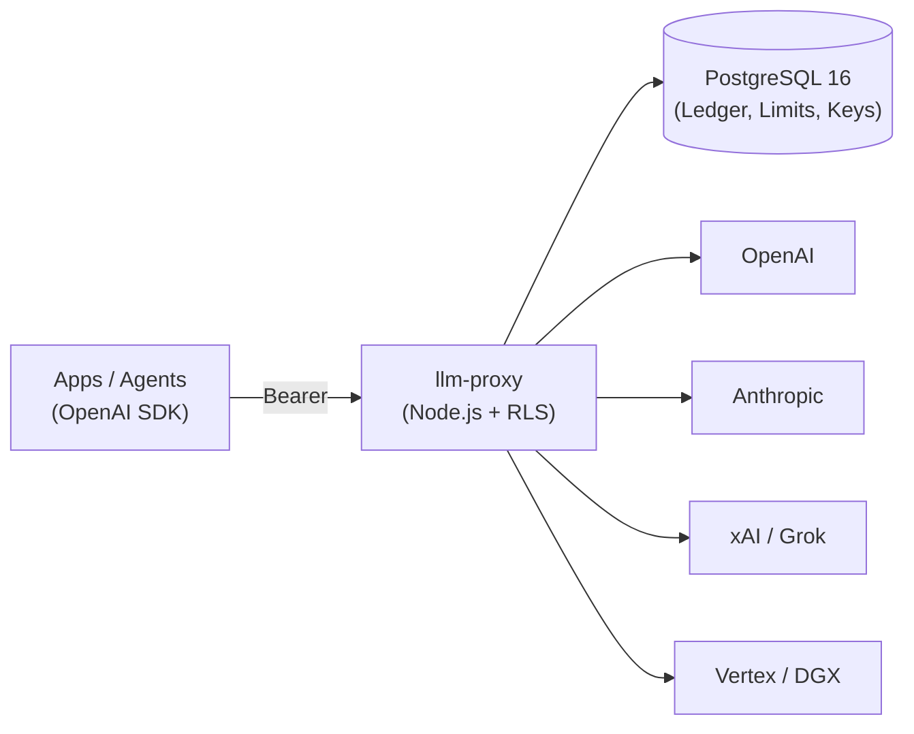

# llm-proxy

**Self-hosted, OpenAI-compatible LLM gateway with zero silent decisions.**

`llm-proxy` sits between your client applications and upstream foundation models. It centralizes API keys, enforces tenant isolation directly in PostgreSQL, tracks exact spend with immutable ledgers, and guarantees that requests never switch models behind your back.

Runs as a single lightweight Node.js container backed only by PostgreSQL 16.

---

## Why, What & How

### Why llm-proxy?
- **No Leaked Keys:** Your applications hold a single tenant secret. Upstream provider keys (OpenAI, Anthropic, xAI, Vertex, etc.) stay encrypted at rest in PostgreSQL with AES-256-GCM.
- **Auditable & Strict:** A named model request (`gpt-4o-mini`, `claude-sonnet-5-5`, etc.) **never** silently switches models or providers.
- **Database-Enforced Tenant Isolation:** Every query runs under PostgreSQL Row-Level Security (RLS) bound to the caller's tenant.
- **Honest Cost Accounting:** Every token and dollar figure is strictly estimated, provisional, or unknown—never assumed or spoofed.
- **No Third-Party Control Plane:** Completely private in your VPC or on-prem. No external analytics, telemetry, or hosted SaaS dependencies.

### What Does It Provide?
- **Standard Interface:** Drop-in OpenAI-compatible endpoint (`POST /v1/chat/completions` and `GET /v1/models`) supporting streaming (SSE) and unary modes.
- **Multi-Provider Support:** Adapters for OpenAI, Anthropic, xAI (Grok), Google Vertex AI, OpenRouter, and custom self-hosted endpoints (e.g., DGX).
- **Traffic Governance:** Granular tenant quotas (RPM, concurrency, streaming leases, token rate limits) and hard monthly spend budgets.
- **Reliability Controls:** Configurable deadlines, circuit breakers, and automatic retries before any bytes stream.
- **Continuous Learning & Cost Optimization:** Offline evaluation replays, evidence-backed qualification, canary routing, and cost-based selection for the `auto` alias.

### How Does It Work?



1. **Authentication:** Authenticates `X-Tenant-ID` and Bearer token against a scrypt verifier, establishing PostgreSQL RLS session context.
2. **Admission & Limits:** Verifies tenant budget, rate limits (RPM), and concurrency ceilings before placing a token lease reservation.
3. **Model Resolution:** Direct named models route immediately to the registered provider deployment; the `auto` alias routes through governed policies.
4. **Adapter Execution:** Normalizes request payload into upstream provider format and returns standard OpenAI chat completions or SSE chunks.
5. **Cost & Telemetry Settlement:** Calculates exact token usage and costs, settles budget reservations, and records sanitized telemetry into the database.

---

## Quickstart (Under 2 Minutes)

### Prerequisites
- Docker & Docker Compose (or [Colima](https://github.com/abiosoft/colima) on macOS)
- Node.js 24+ & `curl`

### 1. Launch Stack
```bash
export DOCKER_HOST="unix://${HOME}/.colima/default/docker.sock" # if using Colima
./llm-proxy-docker.sh setup
./llm-proxy-docker.sh build
./llm-proxy-docker.sh start
```

### 2. Configure Upstream Provider Keys
Add your provider keys to `config/provider-keys.env` (mode 600, gitignored), then register deployments:
```bash
./llm-proxy-docker.sh keys
```
This enables inference, registers deployments, and creates your initial credentials in `config/local-tenant.json`.

### 3. Send a Chat Completion
Use `curl` or any OpenAI SDK:
```bash
curl -s http://127.0.0.1:8080/v1/chat/completions \
  -H "X-Tenant-ID: <tenant-id>" \
  -H "Authorization: Bearer <tenant-secret>" \
  -H "Content-Type: application/json" \
  -d '{
    "model": "auto",
    "messages": [{"role": "user", "content": "Explain zero-trust architecture in one sentence."}]
  }'
```

---

## Documentation Map

Explore comprehensive technical documentation organized by intent:

### 🚀 Getting Started & Operations
- **[Operations Guide](docs/operations.md)** – CLI commands, interactive management, environment variables, health checks, migrations, and incident runbooks.
- **[Architecture Deep Dive](docs/architecture.md)** – Detailed module map, trust boundaries, data schema, and local runtime design.
- **[GCP Deployment](docs/gcp-deployment.md)** – Cloud deployment guide using OpenTofu / Terraform for Google Cloud VPC.
- **[Market Comparison](docs/comparison.md)** – Technical comparison against LiteLLM, Kong, Portkey, Envoy AI Gateway, and Cloudflare.

### 🛡️ Core Proxy Capabilities
- **[Chat API](docs/chat.md)** – OpenAI-compatible `POST /v1/chat/completions`, error shapes, and header conventions.
- **[Tenant Isolation](docs/tenants.md)** – PostgreSQL Row-Level Security, key rotation, and credential management.
- **[Provider Adapters](docs/providers.md)** – Supported providers (OpenAI, Anthropic, xAI, Vertex, DGX), capability maps, and pricing models.
- **[Streaming (SSE)](docs/streaming.md)** – Server-Sent Events architecture, streaming leases, and concurrency caps.
- **[Limits & Budgets](docs/limits.md)** – Rate limits (RPM/TPM), concurrency ceilings, and monthly spend controls.
- **[Cost Tracking](docs/cost.md)** – Transparent price registration, provisional states, and immutable accounting.
- **[Resilience (Retry, Fallback & Breakers)](docs/retry.md)** – Deep dives into [Retry Policies](docs/retry.md), [Auto Fallback](docs/fallback.md), and [Circuit Breakers](docs/breaker.md).
- **[Metrics & Characteristics](docs/metrics.md)** – Telemetry logging, latency percentiles, and optional encrypted sample capture.

### 🧠 Continuous Learning & Governance
- **[Routing & Governed Selection](docs/operations.md#routing-policy)** – Shadow ranking, evidence qualification, and cost-optimal model routing.
- **[Performance Rig](docs/performance-rig.md)** – Blind LLM evaluation harness and automated benchmark suites.
- **[Performance Benchmarks](docs/performance.md)** – Baseline execution timings, throughput, and memory profiles.
- **[Statistical Significance Analysis](docs/statistical-significant.md)** – Formal statistical verification, Welch's $t$-tests ($p$-values), confidence intervals, and concurrency regression ($R^2 = 0.97$).

### 🧪 Live End-to-End Validation
- **[Test 1: Core Lifecycle](docs/e2e/test-1.md)** – Full end-to-end setup and smoke execution.
- **[Test 2: Failure & Recovery](docs/e2e/test-2.md)** – Resiliency, error handling, and recovery validations.
- **[Test 3: Provider Interoperability](docs/e2e/test-3.md)** – Multi-provider integration across live endpoints.
- **[Test 4: Three-Model Baseline](docs/e2e/test-4-full.md)** – OpenAI, Anthropic, and xAI baseline comparisons.
- **[Test 5: Adaptive Refresh](docs/e2e/test-5-learn.md)** – Continuous learning snapshot refresh.
- **[Test 6: Cost-Based Auto-Routing](docs/e2e/test-6-cost-switch.md)** – Automated cost-optimal routing across 73 evaluation pairs.
- **[Test 7: Enterprise Scale & Concurrency](docs/e2e/test-7-enterprise-scale.md)** – Multi-tenant scale benchmark (Startup, Mid-Sized Enterprise, Large Enterprise) across 1 to 30 concurrent users.

---

## Roadmap

- **Automatic Optimizer:** Governed selection is shipped; fully automated unattended promotion stays off by default.
- **Redis Cache Layer:** In-memory caching for hot rate counters (PostgreSQL currently handles evaluation & state).
- **External Secret Managers:** Native integrations with AWS Secrets Manager, GCP Secret Manager, and HashiCorp Vault.
- **Hardware-Validated Private DGX Endpoints:** Official verification suite for on-premise NVIDIA DGX clusters.

---

## License

[MIT](LICENSE)
