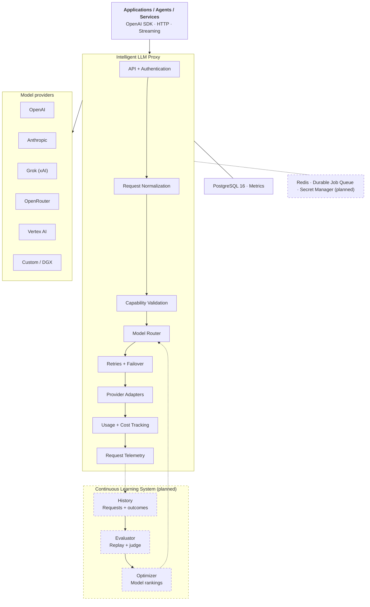

# llm-proxy

llm-proxy is a self-hosted, OpenAI-compatible LLM gateway that makes no silent decisions.

It runs inside your network and needs only PostgreSQL. Your apps keep one client and one request format. The proxy keeps the provider keys, the models each tenant may call, and the rules for spend, retries, and failover. It does only what you approved, and it shows you what it did.

Two words appear throughout. A **tenant** is one team or app with its own secret, models, limits, and budget. A **deployment** is one model at one provider that you registered.

## Why llm-proxy

Your LLM gateway holds every provider key that you own. It also sees every prompt that you send. That makes it one of the most trusted parts of your stack. Many teams pick one in an afternoon.

Without a gateway, each app has its own provider keys in its own `.env` file. Keys leak, spend is hard to stop, and nobody can say which model answered which request. A gateway fixes that. But many gateways also decide things for you: they switch to a different model when a provider fails or a budget runs out, or they keep a control plane on the vendor's network.

llm-proxy is built on three promises:

- **Contained.** Provider keys and prompts stay inside your network. A caller never sees a provider key or a provider URL. The database enforces tenant isolation.
- **Approved.** Every control is off until you turn it on. A request that names a model never switches to a different model. Fallback happens only for the alias `auto`, only to a deployment that passed your policy, and only before the first byte of output.
- **Provable.** Each attempt records which deployment answered and what it cost. Each cost is estimated (verified price, full usage), provisional (unverified price or partial usage), or unknown (no usage reported). A timeout is never recorded as a zero-cost call.

## High-level architecture



Solid lines are shipped. Dashed lines are planned. Today the only runtime dependency is PostgreSQL 16.

### How a request flows

1. **API + Authentication.** The caller sends `X-Tenant-ID` and a tenant secret. The proxy checks the secret against a scrypt verifier. From here, every database query runs as that tenant under PostgreSQL row-level security.
2. **Request Normalization.** The body becomes one standard request format. The same JSON works for every provider.
3. **Capability Validation.** Each deployment lists the fields it accepts, such as `temperature` or `stop`. The proxy refuses a field the deployment does not accept. It does not drop the field and continue.
4. **Model Router.** `model` is the alias `auto` or the name of an enabled deployment. The router resolves it to one deployment. A named model never changes.
5. **Circuit breaker and limits.** An open circuit breaker rejects the attempt before any provider call. Then rate, concurrency, and budget limits are checked, and the proxy sets aside budget for this call.
6. **Provider Adapters.** One adapter per provider family turns the canonical request into the provider's API and back into an OpenAI chat completion or a streamed response.
7. **Retries + Failover.** Retry makes at most one more attempt on the same deployment, within one deadline. Fallback moves `auto` to one approved deployment, only before any output. A new attempt goes back to step 5.
8. **Usage + Cost Tracking.** Each attempt is priced from prices that you registered. The budget reservation is settled.
9. **Request Telemetry.** Each request and attempt is stored for the tenant's metrics. Response headers `x-deployment`, `x-attempt-count`, and `x-fallback` show what happened.

Each box maps to code in `src/`. See [Architecture](docs/architecture.md) for the module map, the data model, and the trust boundaries.

### Continuous Learning System (planned, not built)

The learning system closes the loop from your own traffic:

- **History** stores each request and its outcome: the deployment, the latency, the cost, and the result.
- **Evaluator** replays stored requests against other deployments and scores them with a judge model.
- **Optimizer** ranks deployments per task. The router can then use these rankings for `auto`, inside the same policy checks that fallback uses today.

It will need Redis and a durable job queue for replay work. This release does not include it. The router does not choose a model by quality score today.

### How this architecture compares

LLM gateways follow a few designs. Each design puts the trust boundary in a different place.

| Design | Examples | Where prompts and keys live | Tenant isolation | Trade-off |
| --- | --- | --- | --- | --- |
| Hosted aggregator | OpenRouter, Cloudflare AI Gateway | Vendor network | Vendor app logic | No ops work. Traffic and keys leave your network. |
| Hybrid (gateway in your network, vendor control plane) | Portkey hybrid, Kong Konnect, Azure APIM self-hosted gateway | Data plane yours, config at vendor | Vendor app logic | Managed console. The control plane is still outside. |
| Self-hosted general gateway | LiteLLM, Bifrost, Helicone gateway | Your network | App logic (teams, virtual keys) | Breadth: many models and features. A large surface in the path of every key. |
| Kubernetes traffic gateway | Envoy AI Gateway (Agent Router), Kong | Your cluster | Route and quota config | Strong traffic control. Needs Kubernetes and service-mesh skills. |
| Cloud-native managed | AWS Bedrock, Azure OpenAI | Your cloud account | IAM | No provider keys. Locked to one cloud's model catalog. |
| Router service | Not Diamond, Martian, RouteLLM | Varies | n/a | Picks a model by quality. Not a gateway. |
| **llm-proxy** | — | **Your network, your Postgres** | **PostgreSQL row-level security** | Small, strict, auditable. Text chat only today. |

The main design differences:

- **Isolation in the database, not only in app code.** The runtime database role cannot bypass row-level security. It cannot read provider key ciphertext or secret verifiers. We found no other gateway that documents database-enforced tenant isolation.
- **Fallback that never joins two models in one answer.** Some gateways continue a broken stream on another model. llm-proxy never falls back after the first byte, so the answer you audit is the answer one model gave.
- **Policy-checked fallback.** A fallback target must be in the same tenant, pass a live check, come from an approved provider, match your data-handling rule, sit in an allowed region, and accept the required fields.
- **Honest cost.** Unknown stays unknown. A hard budget refuses a call whose cost it cannot estimate in advance.
- **One dependency.** PostgreSQL holds config, policy, keys, costs, and the attempt trail. No vendor control plane.

## Why not an existing gateway?

There are many LLM gateways. Most of them compete on breadth: more models, more agents, more tools, and a hosted console. llm-proxy competes on trust in the request path.

| Question | llm-proxy | Typical gateway |
| --- | --- | --- |
| Where does it run? | In your network. Only PostgreSQL is needed. | SaaS, hybrid, or self-hosted with extra services. |
| Who sees the provider keys? | Only the proxy. AES-256-GCM ciphertext; the key is not in Postgres. | Gateway config, env vars, or the vendor's secret store. |
| How are tenants isolated? | PostgreSQL row-level security on every tenant query. | Teams or virtual keys in app logic. Some tiers are enterprise-only. |
| Can my model change without notice? | No. A named model never switches. | Often yes: automatic fallbacks, budget fallbacks, or mid-stream continuation. |
| How do I know what happened? | Headers and per-attempt rows name the deployment, attempt count, and fallback. | Logs or a hosted dashboard. |
| Is a cost figure ever a guess shown as fact? | No. Each amount is estimated, provisional, or unknown. | Often a public price list; failed calls can show $0. |
| License | MIT. No paid enterprise tier. | Mixed: open core with paid enterprise features is common. |

Summary of the market as of October 2026 (full table with sources in [Comparison](docs/comparison.md)):

| Product | Deployment | Mid-stream failover | Tenant isolation | Learning loop |
| --- | --- | --- | --- | --- |
| LiteLLM | Self-host or cloud | Continues a broken stream on another model | Teams; organizations are enterprise-only | No |
| Portkey (now Palo Alto Networks Prisma AIRS) | SaaS or self-host | Not documented | Workspaces | No |
| Kong AI Gateway | Konnect SaaS or self-host enterprise | Not documented | Not documented | Semantic routing |
| Cloudflare AI Gateway | SaaS only | Not documented | Metadata scopes | No |
| OpenRouter | SaaS only | Fallbacks on by default | n/a | No |
| Bifrost | Self-host | Not documented | Customer → team → virtual key | No |
| Envoy AI Gateway / Agent Router | Kubernetes | Not documented | Quota-aware routing | No |
| TensorZero | Self-host | Not documented | Not documented | Yes, but archived June 2026 |
| AWS Bedrock / Azure APIM | Managed in your cloud | Not documented | IAM or subscriptions | Bedrock prompt routing (one model family) |
| **llm-proxy** | **Self-host, Postgres only** | **Never after the first byte** | **Database row-level security** | **Planned** |

Use a different gateway today if you need tools, images, audio, embeddings, MCP, an admin UI, SSO, or hundreds of models through one hosted key. llm-proxy does not include them yet.

## Run it inside your VPC

llm-proxy is built for a network that you control. Keys, costs, policies, and the attempt trail all stay in your own PostgreSQL. Prompts pass through to the provider that you chose and nowhere else.

- **No prompt storage.** The database stores token counts, not prompt or completion text.
- **Small footprint.** One Node.js process and PostgreSQL 16. Seven runtime packages, with a lockfile.
- **No telemetry.** The proxy calls only the providers that you register. It sends nothing to the maintainers or anyone else.
- **Caller never holds a provider key.** The caller sends a tenant id and a tenant secret. It cannot send a provider key or a provider URL.
- **Secrets at rest.** The database stores a scrypt verifier, not the tenant secret. Provider keys are AES-256-GCM ciphertext. The encryption key comes from `PROVIDER_CREDENTIAL_KEY`, not from Postgres.
- **Least-privilege database roles.** The runtime role cannot read provider ciphertext or verifiers. No role that the proxy logs in as can bypass row-level security.
- **Redacted logs.** Logs remove secrets, prompts, and chat messages.
- **No HTTP admin surface.** Tenants, providers, limits, and policies change only through the CLI. No network request can change them. Only an operator with CLI and database access can.
- **Private model endpoints.** A self-hosted model, such as one on DGX, must be on an allowlist with pinned addresses. The proxy does not follow redirects.
- **Data residency.** Fallback checks region and data-handling values, so `auto` never moves a request to a region or provider that your policy did not approve. OpenRouter calls go only to the downstream providers that you list.

The proxy does not terminate TLS. Put TLS on the load balancer or reverse proxy in front of it. See [Operations](docs/operations.md).

## We run on it

The maintainers route every internal product's LLM calls through llm-proxy. Each control in this README, from the breaker to honest cost states, is one that our own traffic needed. When it breaks, it breaks for us first.

## Get started

You need Colima, the Docker CLI, Docker Compose, and curl. Tests and the check script also need Node.js 24. If your shell is on another Node version, run `nvm use 24`, then `npm install`, before `npm test`.

Point Docker at the Colima socket, then start the stack. The script starts Colima when it is down, then PostgreSQL 16 and the proxy on port 8080.

```bash
export DOCKER_HOST="unix://${HOME}/.colima/default/docker.sock"
scripts/colima.sh start
```

`npm run stack -- start` is the same script. `scripts/colima.sh start --build` rebuilds the image. `scripts/colima.sh stop` stops the containers and keeps the database volume. Colima itself stops only with `scripts/colima.sh stop --vm`.

Check the process:

```bash
curl -s http://127.0.0.1:8080/health/live
curl -s http://127.0.0.1:8080/health/ready
```

Live returns `{"status":"live"}`. Ready returns `{"status":"ready","database":"ready"}` when Postgres is up and `schema_migrations` has the latest migration for this image. If it is not ready, the route returns HTTP 503 and live stays 200.

Chat stays off until inference is on and a deployment is enabled. Create a tenant, turn inference on, and register OpenAI:

```bash
docker compose run --rm app node dist/cli.js provision-tenant --name Acme

export INFERENCE_ENABLED=true
export PROVIDER_CREDENTIAL_KEY="$(openssl rand -base64 32)"
export OPENAI_BASE_URL="https://api.openai.com/v1"
docker compose up -d --force-recreate app

docker compose run --rm app node dist/cli.js register-openai-connection \
  --tenant-id <tenant-id> --api-key "$OPENAI_API_KEY"
docker compose run --rm app node dist/cli.js register-deployment \
  --tenant-id <tenant-id> \
  --name primary \
  --upstream-model gpt-4o-mini \
  --timeout-ms 30000 \
  --capabilities temperature \
  --enabled true
docker compose run --rm app node dist/cli.js set-alias \
  --tenant-id <tenant-id> --alias auto --deployment primary
```

The CLI prints the tenant secret once. Save it. The database stores only a verifier.

```bash
curl -s http://127.0.0.1:8080/v1/chat/completions \
  -H "X-Tenant-ID: <tenant-id>" \
  -H "Authorization: Bearer <tenant-secret>" \
  -H "content-type: application/json" \
  -d '{"model":"auto","messages":[{"role":"user","content":"hello"}]}'
```

`model` is `auto` or the name of an enabled deployment. Other providers use the same request. You change only `model`.

To check a running proxy without calling OpenAI:

```bash
npm run check:deployed -- --prepare-local
```

Compose database passwords are for local development. The proxy listens without TLS. Put TLS on the reverse proxy in front of it.

## Capabilities

- **[Architecture](docs/architecture.md).** Module map, request path, data model, and trust boundaries.
- **[Tenants](docs/tenants.md).** Every call carries a tenant id and a secret. You can add and revoke keys. One tenant cannot read another tenant's rows.
- **[Chat](docs/chat.md).** `POST /v1/chat/completions` and `GET /v1/models`. Text only. Success and errors use the OpenAI shape.
- **[Providers](docs/providers.md).** OpenAI, Anthropic, Vertex, xAI, OpenRouter, and one private DGX endpoint per tenant. You store the key. The caller does not.
- **[Streaming](docs/streaming.md).** Server-sent events for a text chat. Off until you enable it for the tenant and the deployment.
- **[Retry](docs/retry.md).** One more attempt on the same deployment, with deadlines. Off until you turn it on.
- **[Fallback](docs/fallback.md).** One more deployment for the alias `auto`, and only before any output. A named model never switches.
- **[Limits and budgets](docs/limits.md).** Shared caps on rate, concurrency, and monthly spend. Start in observation mode.
- **[Cost](docs/cost.md).** You register the price. Each attempt is estimated, provisional, or unknown. The proxy does not take a payment.
- **[Circuit breaker](docs/breaker.md).** An optional breaker per deployment. An open breaker returns HTTP 503 and does not call the provider.
- **[Metrics](docs/metrics.md).** Counts, latency, stream percentiles, attempts, breaker state, and cost for the caller's own tenant.
- **[Operations](docs/operations.md).** Configuration, health, shutdown, migrations, incidents, and tests.
- **[Comparison](docs/comparison.md).** The LLM gateway market, with sources.

## Roadmap

- **Continuous Learning System:** History, Evaluator, and Optimizer, as shown in the architecture.
- **Redis and a durable job queue** for replay and evaluation work.
- **External secret manager** support for provider keys.
- **A verified live call to a private endpoint** (DGX), so it can be `validated_live`.

## Not included

- Login, OAuth, SSO, user accounts, and saved caller state.
- Tools, images, audio, embeddings, and MCP.
- A verified live call to DGX. A DGX deployment is not `validated_live`.
- Choosing a model by a quality score.
- An HTTP admin API or admin UI. Tenants, providers, limits, and policies change through the CLI.
- TLS on the proxy listen port.
- A payment flow.

## License

MIT. See [LICENSE](LICENSE).
