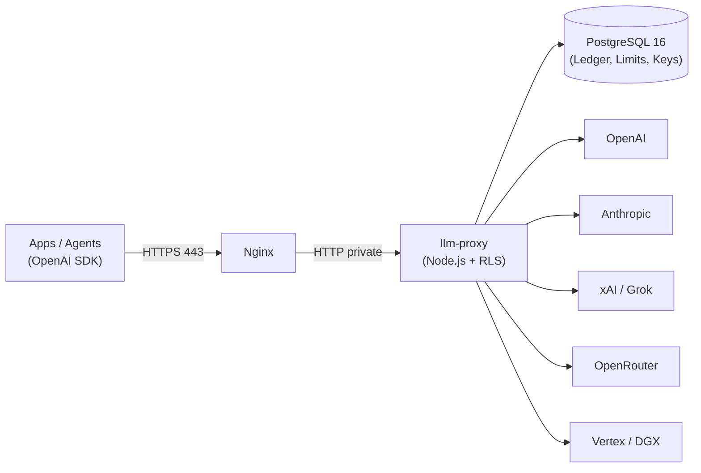

# llm-proxy

**Self-hosted, OpenAI-compatible LLM gateway with zero silent decisions.**

`llm-proxy` sits between your client applications and upstream foundation models. It centralizes API keys, enforces tenant isolation directly in PostgreSQL, tracks exact spend with immutable ledgers, and guarantees that requests never switch models behind your back.

Runs as a single lightweight Node.js container backed only by PostgreSQL 16.

---

## Why, What & How

### Why llm-proxy?

- **No Leaked Keys:** Your applications hold a single tenant secret. Upstream provider keys (OpenAI, Anthropic, xAI, Vertex, etc.) stay encrypted at rest in PostgreSQL with AES-256-GCM.
- **Approved & Auditable:** A named model request (`gpt-4o-mini`, `claude-sonnet-5-5`, `grok-4.7`, etc.) **never** silently switches models or providers. What you test in audit or production is what executes.
- **Database-Enforced Tenant Isolation:** Every query runs under PostgreSQL Row-Level Security (RLS) bound to the caller's tenant context. The runtime database role cannot bypass RLS or view key ciphertext.
- **Honest Cost Accounting:** Every token and dollar figure is strictly estimated, provisional, or unknown. Failed attempts are never hidden or reported as $0.
- **Never Mid-Stream Failover:** Broken streams are never spliced into another model's tokens. The output you audit is the exact output one model produced.
- **No Third-Party Control Plane:** Completely private in your VPC or on-prem datacenter. No external telemetry, no vendor analytics, and no third-party data residency risk.

### What Does It Provide?

- **Standard Interface:** Drop-in OpenAI-compatible endpoints (`POST /v1/chat/completions` and `GET /v1/models`) supporting Server-Sent Events (SSE) streaming and unary modes.
- **Function Tools:** Anthropic, Vertex, xAI, and OpenRouter accept the same function-calling request and return a tool call. A stream returns each tool-call delta with its index, id, and function name. The application executes the function. The proxy does not execute the function. The proxy does not execute a partial argument fragment. A live DGX host does not receive function tools. A loopback DGX mock can stream the same tool call.
- **Multi-Provider Adapters:** Native adapters for OpenAI, Anthropic, xAI (Grok), Google Vertex AI, OpenRouter, and private self-hosted endpoints (e.g., NVIDIA DGX).
- **Traffic Governance & Quotas:** Granular per-tenant quotas for rate limits (RPM/TPM), concurrent request caps, active streaming lease pools, and monthly spend budgets.
- **Resilience Controls:** Configurable request deadlines, circuit breakers, and retry policies before any stream output begins.
- **Continuous Learning & Cost Optimization:** Offline evaluation replays, deterministic checks, evidence qualification, shadow ranking, canary rollouts, and cost-based selection for the `auto` alias.

### How Does It Work?



1. **Authentication:** Checks caller `X-Tenant-ID` and Bearer token against a scrypt verifier, establishing PostgreSQL RLS session context.
2. **Admission & Limits:** Validates tenant budget, rate limits (RPM/TPM), and concurrency ceilings before allocating a token lease.
3. **Model Resolution:** Named models route directly to the designated deployment; the `auto` alias evaluates active canary rollouts or governed cost-optimal routing policies.
4. **Adapter Execution:** Normalizes request payload into upstream provider format and returns standard OpenAI completions or SSE chunks.
5. **Cost & Telemetry Settlement:** Computes token counts and prices, settles budget reservations, and records sanitized telemetry into the database.

---

## Quickstart (Under 2 Minutes)

### Prerequisites
- Docker & Docker Compose (or [Colima](https://github.com/abiosoft/colima) on macOS)
- Node.js 24+ & `curl`

### 1. Launch Stack
```bash
export DOCKER_HOST="unix://${HOME}/.colima/default/docker.sock" # if using Colima
./llm-proxy-docker.sh setup
./llm-proxy-docker.sh build
./llm-proxy-docker.sh start
```

### 2. Configure Upstream Provider Keys
Add your provider keys to `config/provider-keys.env` (mode 600, gitignored), then register deployments:
```bash
./llm-proxy-docker.sh keys
```
This enables inference, registers deployments, and creates your initial credentials in `config/local-tenant.json`.

### 3. Send a Chat Completion
Use `curl` or any OpenAI SDK:
```bash
curl -s --cacert config/ingress/live/ca.crt https://127.0.0.1/v1/chat/completions \
  -H "X-Tenant-ID: <tenant-id>" \
  -H "Authorization: Bearer <tenant-secret>" \
  -H "Content-Type: application/json" \
  -d '{
    "model": "auto",
    "messages": [{"role": "user", "content": "Explain zero-trust architecture in one sentence."}]
  }'
```

---

## Documentation Map

Explore technical documentation organized by intent:

### Getting Started, Operations & Deployment
- **[Operations Guide](docs/operations.md)** – CLI commands, interactive management, environment variables, health checks, migrations, and incident runbooks.
- **[Architecture Deep Dive](docs/architecture.md)** – Comprehensive module map, trust boundaries, data schema, and local runtime design.
- **[GCP Deployment](docs/gcp-deployment.md)** – Production deployment guide using OpenTofu / Terraform for Google Cloud VPC.
- **[Market Comparison](docs/comparison.md)** – Detailed comparison table with sources across LiteLLM, Kong, Portkey, Envoy AI Gateway, Bedrock, and Cloudflare.

### Core Proxy Capabilities
- **[Chat API](docs/chat.md)** – OpenAI-compatible `POST /v1/chat/completions`, function tools, error shapes, and header conventions.
- **[Tenant Isolation & Security](docs/tenants.md)** – PostgreSQL Row-Level Security, key rotation, and credential management.
- **[Provider Adapters](docs/providers.md)** – Supported providers (OpenAI, Anthropic, xAI, Vertex, DGX), capability maps, and manual registration via `--api-key-stdin`.
- **[Streaming](docs/streaming.md)** – Server-Sent Events architecture, tool-call deltas, streaming leases, and concurrency caps.
- **[Limits and Budgets](docs/limits.md)** – Rate limits (RPM/TPM), concurrency ceilings, and monthly spend controls.
- **[Cost Tracking](docs/cost.md)** – Transparent price registration, provisional states, and immutable accounting ledgers.
- **[Circuit Breaker](docs/breaker.md)** – Per-deployment failure tracking and automated 503 fast rejection.
- **[Retry Policies](docs/retry.md)** – Bounded retry attempts with deadlines before response delivery.
- **[Auto Fallback](docs/fallback.md)** – Policy-checked fallback targets for `model=auto` before any output bytes stream.
- **[Metrics & Characteristics](docs/metrics.md)** – Latency distributions, stream percentiles, [request characteristics](docs/metrics.md#request-features), and [encrypted sample capture](docs/metrics.md#encrypted-samples).

### Continuous Learning, Governance & Performance
- **[Routing Policy & Governance](docs/operations.md#routing-policy)** – Deep dives into [evidence qualification](docs/operations.md#evidence-qualification), [shadow ranking](docs/operations.md#shadow-ranking), [canary routing](docs/operations.md#canary-routing), and [governed promotion](docs/operations.md#governed-promotion).
- **[Continuous Learning Evaluation System](docs/architecture.md#evaluation)** – Pinned replay, deterministic checks, judge rubrics, and offline evaluation schedules.
- **[Performance Benchmarks](docs/performance.md)** – Baseline timings, throughput rates, and memory profiles from evidence runs.
- **[Performance Rig](docs/performance-rig.md)** – Automated multi-model test rig scoring quality, latency, and cost under load.
- **[Statistical Significance Analysis](docs/statistical-significant.md)** – Formal hypothesis testing ($p$-values), confidence intervals, and concurrency regression ($R^2 = 0.97$).

### Live End-to-End Validation
- **[Test 1: Core Lifecycle](docs/e2e/test-1.md)** – Full end-to-end setup and smoke execution.
- **[Test 2: Failure & Recovery](docs/e2e/test-2.md)** – Resiliency, error handling, and recovery validations.
- **[Test 3: Provider Interoperability](docs/e2e/test-3.md)** – Multi-provider integration across live endpoints.
- **[Test 4: Three-Model Baseline](docs/e2e/test-4-full.md)** – OpenAI, Anthropic, and xAI baseline comparisons.
- **[Test 5: Adaptive Refresh](docs/e2e/test-5-learn.md)** – Continuous learning snapshot refresh.
- **[Test 6: Cost-Based Auto-Routing](docs/e2e/test-6-cost-switch.md)** – Automated cost-optimal routing across 73 evaluation pairs.
- **[Test 7: Enterprise Scale & Concurrency](docs/e2e/test-7-enterprise-scale.md)** – Multi-tenant scale benchmark (Startup, Mid-Sized Enterprise, Large Enterprise) across 1 to 30 concurrent users.

---

## Roadmap

- **Automatic Optimizer:** Governed selection is shipped; fully automated unattended promotion stays off by default.
- **Redis Cache Layer:** In-memory caching for hot rate counters (PostgreSQL currently handles evaluation & state).
- **External Secret Managers:** Native integrations with AWS Secrets Manager, GCP Secret Manager, and HashiCorp Vault.
- **Hardware-Validated Private DGX Endpoints:** Official verification suite for on-premise NVIDIA DGX clusters.

---

## What is Not Included

- Login, OAuth, SSO, user accounts, and saved caller state.
- Images, audio, embeddings, and MCP.
- An optimizer that promotes a policy without an operator.
- An HTTP admin UI. Tenants, providers, limits, and prices change through the CLI.
- TLS on the Node.js listen port. Nginx in Compose terminates TLS on port 443. The Node.js port stays private.
- A payment or billing collection flow.

---

## License

[MIT](LICENSE)
