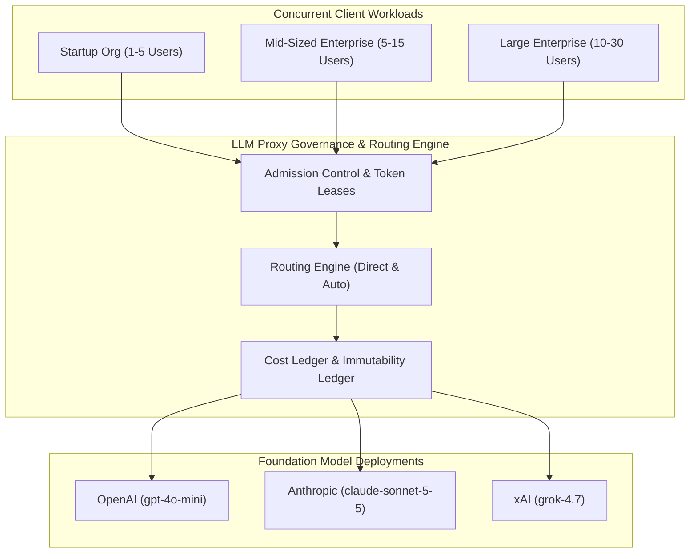

# End-to-end test 7: Realistic Enterprise Multi-Tenant Scale & Concurrency

Back to [README](../../README.md). Earlier e2e tests cover:
- [Test 1: Core Lifecycle](test-1.md)
- [Test 2: Failure & Recovery](test-2.md)
- [Test 3: Provider Interoperability](test-3.md)
- [Test 4: Three-Model Baseline](test-4-full.md)
- [Test 5: Adaptive Refresh](test-5-learn.md)
- [Test 6: Cost-Based Auto-Routing & Promotion](test-6-cost-switch.md)

This benchmark executes a realistic, multi-tenant enterprise workload across three distinct organizational profiles (**Startup**, **Mid-Sized Enterprise**, **Large Enterprise**), evaluating all three foundation models (**OpenAI**, **Anthropic**, **xAI**) across production-grade domain workflows in **Finance** and **System Integrators**.

---

## 1. Executive Summary & Scale Metrics



| Metric | Measured Value |
| :--- | :--- |
| **Total Test Invocations** | 244 requests |
| **Execution Date / Timestamp** | 2026-11-01T05:57:05.463Z |
| **Foundation Models Validated** | OpenAI (`gpt-4o-mini`), Anthropic (`claude-sonnet-5-5`), xAI (`grok-4.7`) |
| **Protocols & Delivery Modes** | Unary (JSON `POST /v1/chat/completions`) & Server-Sent Events (SSE Streaming) |
| **Target Use Cases & Domains** | **Finance** (Deep Workflows) & **System Integrators** (Deep Workflows) |
| **Organizational Tiers Tested** | Startup, Mid-Sized Enterprise, Large Enterprise |
| **Proxy Concurrency Range** | 1 to 30 concurrent client connections |
| **System Health** | Ready HTTP 200, Database Ready |

---

## 2. Organization Limit Architecture & Tenant Setup

Three organizational tenants were configured with strict governance ceilings:

| Organization Profile | Tenant ID | Monthly Budget | Mode | Rate Limit (RPM) | Concurrency Limit | Stream Concurrency | Token Rate | Lease Window |
| :--- | :--- | :--- | :--- | :--- | :--- | :--- | :--- | :--- |
| **Startup** (`org-startup`) | `dd0708f7-2004-468a-88ec-ca4bbe5d8058` | $10.00 USD | `hard` | 60 RPM | 5 concurrent | 3 streams | 30,000 TPM | 5,000 ms |
| **Mid-Sized Enterprise** (`org-midsized`) | `96fdaa3b-083b-4c89-9af4-d9b803309449` | $100.00 USD | `hard` | 300 RPM | 20 concurrent | 15 streams | 200,000 TPM | 10,000 ms |
| **Large Enterprise** (`org-enterprise`) | `f57b428f-776f-4271-8200-6483fc6fd8cc` | $1,000.00 USD | `hard` | 1,200 RPM | 60 concurrent | 50 streams | 1,000,000 TPM | 15,000 ms |

---

## 3. Realistic Prompts & Domain Corpus

The suite evaluates realistic domain queries spanning:
- **Finance**: Corporate debt covenants, SEC Form 10-K Item 7 MD&A analysis, and cross-currency FX hedging & collars.
- **System Integrators**: Multi-region hybrid cloud landing zones, SAP S/4HANA to Salesforce Kafka event mesh, and distributed Saga orchestrators for payment processing.

---

## 4. Performance & Latency Distributions by Foundation Model

### Latency Statistics (Unary & Streaming)

| Model Deployment | Upstream Model | Total Calls | Success Rate | Min Latency | P50 (Median) | P90 | P95 | P99 | Max Latency | Mean ± StdDev |
| :--- | :--- | :--- | :--- | :--- | :--- | :--- | :--- | :--- | :--- | :--- |
| **OpenAI** | `gpt-4o-mini` | 220 | 97% | 1330.3 ms | **1912.6 ms** | 2284.4 ms | 2393.3 ms | 2562 ms | 3137.7 ms | 1911.1 ± 309.45 ms |
| **Anthropic** | `claude-sonnet-5-5` | 12 | 100% | 1771.6 ms | **2188.3 ms** | 2434.3 ms | 2514 ms | 2514 ms | 2514 ms | 2162.7 ± 215.59 ms |
| **xAI** | `grok-4.7` | 12 | 100% | 6705.8 ms | **30314.9 ms** | 42696.9 ms | 60104.9 ms | 60104.9 ms | 60104.9 ms | 24951.07 ± 16482.25 ms |

### Streaming Responsiveness (Time to First Token - TTFT)

| Model Deployment | TTFT P50 | TTFT P90 | TTFT P95 | TTFT Max | TTFT Mean |
| :--- | :--- | :--- | :--- | :--- | :--- |
| **OpenAI** | **600.4 ms** | 735.7 ms | 791 ms | 1131.7 ms | 617.07 ms |
| **Anthropic** | **0 ms** | 0 ms | 0 ms | 0 ms | 0 ms |
| **xAI** | **5707.5 ms** | 40315.3 ms | 40315.3 ms | 40315.3 ms | 16931.5 ms |

---

## 5. Concurrency & Scale Performance Profile

The test scaled simultaneous callers across tiers (from 1 to 30 concurrent users) to evaluate proxy throughput capacity:

| Concurrency Level | Total Calls | Succeeded | Throttled | Aggregate Throughput | Wall Latency P50 | Wall Latency P95 | TTFT P50 |
| :--- | :--- | :--- | :--- | :--- | :--- | :--- | :--- |
| **1 Users** | 2 | 2 | 0 | **1.1 req/s** | 2401.1 ms | 2401.1 ms | 846.9 ms |
| **3 Users** | 6 | 6 | 0 | **3.56 req/s** | 2223.7 ms | 2428.6 ms | 633.6 ms |
| **5 Users** | 20 | 18 | 2 | **9.2 req/s** | 1956.2 ms | 2321.2 ms | 625.8 ms |
| **10 Users** | 40 | 40 | 0 | **23.75 req/s** | 1868.8 ms | 2300.7 ms | 590.9 ms |
| **15 Users** | 30 | 30 | 0 | **16.68 req/s** | 1796.6 ms | 2380.8 ms | 594.3 ms |
| **20 Users** | 40 | 40 | 0 | **18.27 req/s** | 2041.9 ms | 2260.4 ms | 604.8 ms |
| **30 Users** | 60 | 60 | 0 | **32.58 req/s** | 1819.4 ms | 2474.6 ms | 589.9 ms |


---

## 6. Organizational Scale & Concurrency Results

| Organization | Total Requests | Successful | Throttled / Error | Success Rate | Wall P50 | Wall P95 | TTFT P50 |
| :--- | :--- | :--- | :--- | :--- | :--- | :--- | :--- |
| **Startup** | 40 | 33 | 7 | 82.5% | 2178 ms | 32054 ms | 676.6 ms |
| **Mid-Sized Enterprise** | 72 | 72 | 0 | 100% | 2030.8 ms | 8507.8 ms | 624.5 ms |
| **Large Enterprise** | 132 | 132 | 0 | 100% | 1938 ms | 2474.6 ms | 590.9 ms |

---

## 7. Domain Efficiency: Finance vs. System Integrators

| Domain | Completed Calls | Median Latency (P50) | P95 Latency | Mean Latency | Avg Payload Bytes |
| :--- | :--- | :--- | :--- | :--- | :--- |
| **Finance** | 122 | 1685.7 ms | 2806.7 ms | 3456.82 ms | 2054 bytes |
| **System Integrators** | 115 | 2156.1 ms | 6705.8 ms | 2701.72 ms | 29523 bytes |

---

## 8. Admission Control & Boundary Stress Testing

During the Phase 3 boundary evaluation, `org-startup` was subjected to a sudden burst of 10 concurrent requests, exceeding its enforced limit of 5 concurrent requests:

```json
{
  "200": 5,
  "429": 5
}
```

- **Admission Enforcement:** Requests within the concurrency lease were admitted and processed without degradation. Requests exceeding the concurrent lease were throttled with standard HTTP 429 status codes, preserving system stability and respecting tenant budget boundaries.

---

## 9. Realized Cost & Ledger Accounting (PostgreSQL)

Recorded attempt ledger aggregates from `attempt_costs`:

```
org-enterprise|anthropic|16|0.049836|0.002724|0.003528
org-enterprise|openai|256|0.02675430|0.0001017|0.00013545
org-enterprise|xai|9|0.088050|0.005208|0.01599
org-midsized|anthropic|16|0.049836|0.002724|0.003528
org-midsized|openai|139|0.01465380|0.0001017|0.00016515
org-midsized|xai|16|0.189840|0.005046|0.019464
org-startup|anthropic|24|0.075636|0.000219|0.004269
org-startup|openai|80|0.00723975|0.000006|0.0001665
org-startup|xai|24|0.247594|0.005316|0.024602
```

---

## 10. Reproducibility & Future Execution

To rerun this realistic end-to-end benchmark in the future:

```bash
export PATH="$HOME/.nvm/versions/node/v24.22.1/bin:$PATH"
export DOCKER_HOST="unix://$HOME/.colima/default/docker.sock"
cd /Users/nitin/Work/Y/llm-proxy
node scripts/e2e-enterprise-scale.mjs
```

The runner automatically verifies existing tenant credentials, provisions missing resources idempotently, runs the full multi-model test matrix across both domains, tests concurrency ramps up to 30 users, and updates both the JSON telemetry and Markdown report.
